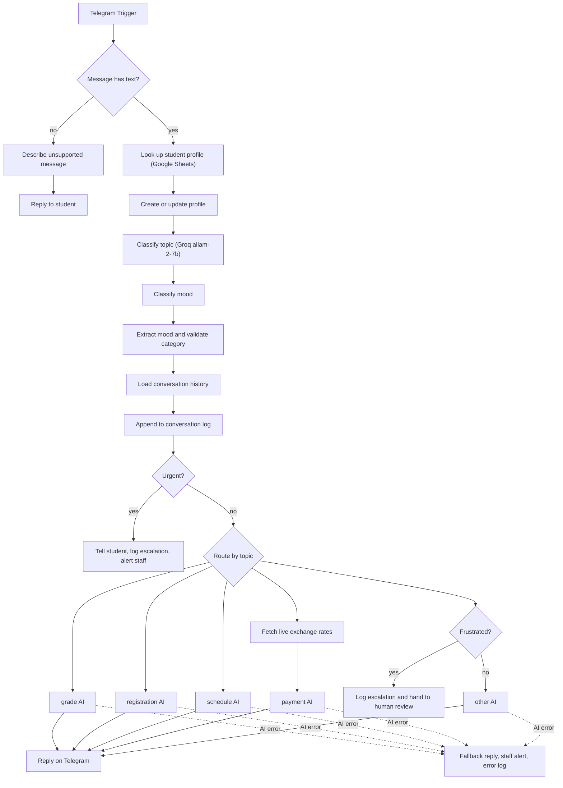

# AI Student Support Agent (Telegram Bot, n8n)

An AI-powered Telegram support bot for university students, built as an n8n workflow for the AI Agent course (24 hours, 18 August to 3 October 2026) run by the Training Center at Princess Sumaya University for Technology (PSUT) in partnership with AI Hub.

Students write to the bot in Arabic or English. The bot works out what the message is about, replies with an answer written for that topic, and hands urgent or upset students to a staff member. Every conversation is logged in Google Sheets.

## What the workflow does

- **Telegram in and out.** A Telegram trigger starts the flow. Messages without text (photos, stickers and so on) get a clear "unsupported message" reply.
- **Student profile.** Each student is looked up in Google Sheets by their Telegram chat. A new profile is created on first contact, otherwise message count and last-seen time are updated.
- **Topic classification.** A Groq model (`allam-2-7b`, through n8n's LangChain Basic LLM Chain node) labels each message as `grade`, `registration`, `payment`, `schedule` or `other`. A code node validates the label and turns anything unexpected into `other`.
- **Mood classification.** A second LLM call returns a mood (urgent, frustrated, confused, happy or neutral) with a confidence from 1 to 10. The label is only trusted at confidence 7 or higher. A keyword guard in code forces `urgent` when the message literally says so, in English or Arabic.
- **Conversation memory.** Earlier messages from the same student are read from the conversation log and passed to the model as background. A short follow-up inherits the topic of the previous message, and a bare greeting or thank-you does not.
- **Topic-specific replies.** Five separate LLM chains (grade, registration, payment, schedule, other) each have their own prompt. They answer in the language of the student's message and receive the detected mood.
- **Live exchange rates.** Payment questions first fetch rates from open.er-api.com (base JOD). A code node formats the rates, so currency conversion is done from real numbers instead of by the model.
- **Urgent escalation.** An urgent message is acknowledged to the student, logged in an Escalations sheet and sent to staff as a Telegram alert.
- **Human review.** A frustrated student whose message is classified as `other` is logged in the Escalations sheet and told that a staff member will help.
- **Error handling.** Every LLM node has an error output. A failure sends the student a fallback reply, alerts staff on Telegram and writes a row to an Error Log sheet.

## Flow

## Tech stack

n8n, Telegram Bot API, Groq (`allam-2-7b`) through the n8n LangChain nodes, prompt engineering, Google Sheets (OAuth2), open.er-api.com REST API, JavaScript code nodes.

## Setup

1. In n8n choose **Workflows > Import from file** and select `student-support-agent.workflow.json`.
2. Create three credentials and attach them to the nodes (credentials are not included in the export): a Telegram bot token from @BotFather, a Groq API key, and Google Sheets OAuth2.
3. Create a Google spreadsheet with four tabs and set it as the document in every Google Sheets node (the export contains the placeholder `YOUR_GOOGLE_SHEET_ID`). The workflow uses these column names exactly as written, including the spellings `Massage` and `Total massages` and the trailing space in `First name ` and `First contact `:

   | Tab | Columns |
   | --- | --- |
   | student profile | Student Id, First name , Total massages, First contact , Last seen |
   | conversation log | TimeStamp, Student Id, Name, Massage, Category, Mood |
   | Escalations | Student Id, Category, Count, Priority, Date, Key |
   | Error Log | Timestamp, Source, Student Id, Message, Error |

4. Replace `YOUR_STAFF_TELEGRAM_CHAT_ID` in the two staff alert nodes with the chat ID that should receive alerts.
5. The contact details inside the prompts (`it-support@example.edu`, `finance@example.edu`) are placeholders. Replace them with real ones.
6. Activate the workflow.

## Known limitations

- This is a course project. No usage numbers or production results are claimed for it.
- The model is small, so classification can be wrong. The keyword guard for urgent messages exists for that reason.
- Only the `other` topic checks for a frustrated student. A frustrated student asking about grades, registration, payments or schedules gets a normal answer, and the detected mood is passed to the prompt.
- The workflow still contains an "IT Support" branch with a fixed reply. It cannot be reached, because the topic classifier and the validation step only allow the five topics above.
- The error-notification workflow that the original instance used is not included in this export.

## Author

Hamzeh Borini, AI graduate, University of Jordan. [LinkedIn](https://www.linkedin.com/in/hamzehborini)

Released under the MIT License.
